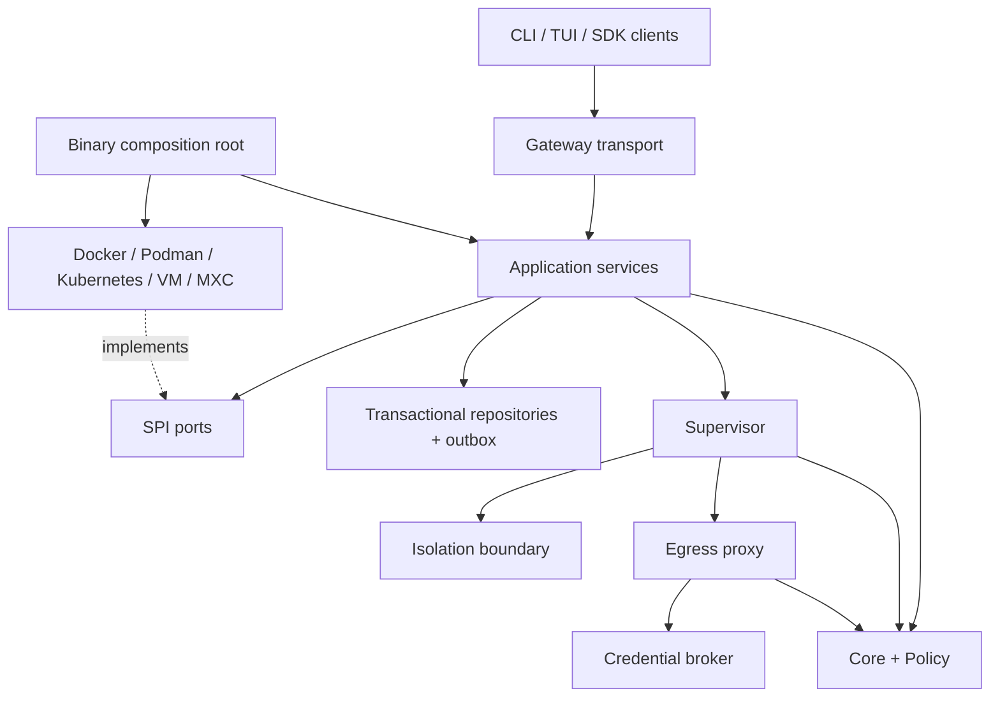
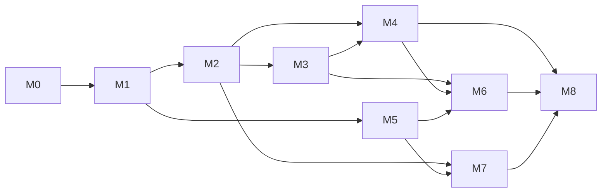

# Новый план полной реализации OpenShell на Go

Версия плана: 1.0 · 2026-10-21 · Основание: REVIEW.md и локальный baseline OpenShell v0.1.4.

## 1. Зафиксированное решение

Создать самостоятельную модульную реализацию функциональности OpenShell на Go. Текущий код Quarshell/Quarshell разрешено заменять целиком. Новая архитектура не обязана сохранять старые внутренние интерфейсы, API Quarshell, конфиги, env aliases, layout state, images и дополнительные возможности прежнего продукта.

Функциональным эталоном служит OpenShell v0.1.4, commit `5a7728c304b5528e954e9ae900cf21f84e1a12b1`. Наличие этого baseline подтверждено локальными материалами. Следующий upstream-релиз принимается отдельным пересмотром inventory, а не незаметным изменением требований посреди работ.

Рабочее имя новой реализации — Quarshell, поскольку оно уже выбрано в актуальных release-документах. Namespace организации — `github.com/KLORQ`; это не означает сохранение старой реализации. Все новые команды, переменные и каталоги используют одно продуктовое имя.

Под «всем функционалом» здесь понимаются пользовательские операции, семантика policy/config, ограничения безопасности, жизненный цикл, плагины, backend и инструменты, перечисленные ниже. Нельзя завершить перенос удалением upstream-возможности из matrix. Промежуточный milestone может иметь ограниченный scope, но не называется полным релизом.

### Что означает Go

Gateway, supervisor, isolation orchestration, policy engine, proxy, providers, CLI, TUI, Go SDK и prover orchestration пишутся на Go. Старые Rust OpenShell binaries не вызываются из production. Upstream может запускаться только в отдельном conformance runner как эталон.

ОС, container engines, hypervisors, Z3, GPU drivers и системные API остаются внешними зависимостями там, где они нужны. Полный отказ от любых native dependencies — отдельный объём работ, не следствие переноса логики на Go. В частности, libkrun — native dependency, даже если Go вызывает её через FFI без cgo. Каждый native компонент проходит отдельное архитектурное решение, pin и packaging gate.

Чтобы сохранить Python/TypeScript клиентскую поверхность OpenShell, тонкие SDK остаются на соответствующих языках и обращаются к Go-сервисам. Вся серверная и runtime-логика принадлежит новой Go-реализации.

### Совместимость

Внешний OpenShell wire contract сохраняется как прямой публичный протокол новой реализации, чтобы можно было переносить и проверять клиентов и external extensions. Generated DTO преобразуются в новые domain values на транспортной границе. Это обычное декодирование протокола; слоя вызовов старого Quarshell runtime нет.

Старая Quarshell/Quarshell совместимость не требуется: dual API, env fallbacks, imports aliases, state import и adoption прежних resources исключаются. Чистая установка использует новый state layout. Удаление исходников и старых путей сборки не должно неявно означать удаление пользовательских данных на хосте.

## 2. Полный функциональный контракт

Основная matrix строится по четырём независимым источникам: proto descriptors, дерево CLI, schema/config/provider fixtures, runtime/platform сценарии. Дополнительно отдельно инвентаризируются локальные библиотечные API и packaging.

| Область | Обязательная функциональность | Новый владелец | Критерий завершения |
|---|---|---|---|
| Gateway API | Все 83 OpenShell RPC, errors, auth, pagination, streaming | gateway + proto | Каждый метод имеет positive/negative/permission/cancel fixture |
| Compute API | 12 RPC, включая workspace storage и authentication | driver + proto | Один и тот же contract suite для builtin/remote |
| Credential API | 5 RPC, backend storage, refresh/revoke | credentials | Secret lifecycle без утечки материалов refresh |
| Middleware | 4 RPC SupervisorMiddleware + 1 response service | proxy + extensions | HTTP/WS ordering, cancellation, failure semantics |
| Interceptors | 3 RPC GatewayInterceptor | gateway + extensions | Authenticated transformation и повторная проверка результата |
| Isolation protocol | Exchange/Mediate, framing, identity, FD/network operations | isolation + supervisor | Authenticated boundary, replay/size/loss tests |
| Gateway deployment | local/remote bootstrap, config, health/readiness, TLS, OIDC, operator auth | gateway + CLI | Чистый deploy, restart и корректная конфигурация |
| Sandbox lifecycle | create/start/stop/delete, recovery, desired/observed state | gateway + driver | Повторные запросы и crash points не создают дубликаты |
| Main process | exit finalization, restart policy, foreground attach | supervisor + isolation | Один terminal result на generation, restart semantics |
| Exec/session | exec/PTY, resize, signals, stdin EOF, stdout/stderr, SSH/relay | supervisor + SDK | Интерактивные и non-TTY сценарии всех backend |
| Workspace/services | membership, RBAC, quota, templates, service routing/forward | gateway | Scope нельзя изменить ссылкой на чужую сущность |
| Policy schema | defaults, null/presence, validation, matching, composition | policy | Corpus совпадает с upstream по входам и результатам |
| Policy lifecycle | global/sandbox, versions, ACK, draft/approve/edit/undo/history | gateway + supervisor | Активная policy подтверждена runtime generation |
| Filesystem isolation | read/write/exec grants, workdir, identities, Landlock | isolation | Kernel-enforced ограничения и capability evidence |
| Network isolation | socket mediation, bypass denial, DNS/IPv4/IPv6/UDS | isolation + proxy | Raw socket/direct-connect probes не обходят policy |
| L7 enforcement | HTTP, TLS, TCP, WebSocket, JSON-RPC, MCP, GraphQL, SQL semantics | proxy + policy | Allow/deny/limits/protocol error fixtures |
| Credentials | endpoint binding, stable placeholders, refresh, managed files | credentials + supervisor + proxy | Secret доступен только нужной операции/endpoint |
| Token grants | OAuth grants and SPIFFE/subject identity, cache/expiry | credentials | Binding к workspace/sandbox/provider/revision |
| Providers | Profiles, inheritance, label filtering, discovery, builtins | providers | Всё содержимое upstream providers/ покрыто fixtures |
| Compute backends | Docker, Podman, Kubernetes, VM, Windows MXC | driver / driver-vm / driver-mxc | Отдельный живой lane для каждого поддержанного профиля |
| GPU | Resource requests, CDI, passthrough/VFIO где применимо | compute + vm | Реальная выдача/освобождение устройства, resource errors |
| Credential drivers | Database, Kubernetes Secrets, Vault-compatible | credentials | Durable CRUD, auth, rotation и outage |
| Peer control plane | PeerRelay/readiness/endpoint/provider status | gateway | Identity/fencing, reconnect и gateway outage |
| Prover | Policy containment, risk queries, counterexample, coverage, timeout | prover | Within/Exceeds/Unsupported/Inconclusive без ложного allow |
| Observability | OCSF, logs, events, traces, metrics, redaction | telemetry + владельцы событий | Consistent schema и доказанный bounded buffering |
| CLI/TUI | Всё дерево upstream команд, flags, output/exit codes, dashboard | CLI | Сценарии и help inventory, PTY/golden tests |
| SDK | Go API; Python/TS пользовательские поверхности | SDK + client packages | Сценарии against real Go gateway, независимая установка |
| Distribution | Images, Helm, binaries, supported packages/install/uninstall | release tooling | Reproducible artifact, signature, SBOM, clean install |
| Agent tooling/docs | Public skills/examples, troubleshooting, EN/RU guides | docs + CLI | Каждый пример работает с новым продуктом |

Список всех 37 Rust crates и их назначения — `upstream-components.md`. Список 110 RPC — `rpc-inventory.csv`; он задаёт стартовый inventory, а не свидетельство выполненной реализации. Boundary protocol требует также inventory операций внутри stream, поскольку два метода не описывают все варианты сообщений.

## 3. Целевые модули и зависимости

Go package — обычная единица разделения кода. Новый Go module нужен для независимого потребителя, выпуска, платформы или тяжёлой зависимости. Не превращать каждый repository interface в отдельный репозиторий.

Предлагаемая структура сохраняет удобство независимых модулей, но задаёт новые контракты:

| Go module | Содержимое | Допустимые продуктовые зависимости |
|---|---|---|
| `quarshell-core` | Domain IDs, generation, errors, чистые значения | Нет |
| `quarshell-policy` | Authored AST, limits, normalize, evaluate, compose | core |
| `quarshell-proto` | Pinned schemas, generated Go/TS, descriptors | Нет доменных зависимостей |
| `quarshell-spi` | Compute, Isolation, Credential, extension contracts | core, policy только где действительно нужно |
| `quarshell-telemetry` | OCSF, OTEL, redaction; slog helpers как package | core |
| `quarshell-policy` | Profiles, binding rules, provider catalog | core, policy |
| `quarshell-credentials` | Broker, leases, refresh, DB/K8s/Vault drivers | core, spi, providers |
| `quarshell-proxy` | Network/L7, middleware chain, credential injection | core, policy, spi, telemetry |
| `quarshell-isolation` | Linux launcher/broker, identity, syscall/FD boundary | core, spi, telemetry; proto только transport |
| `quarshell-supervisor` | Config sessions, admission, process orchestration | core, policy, spi, telemetry |
| `quarshell-driver` | Docker/Podman/Kubernetes packages и composition | core, spi |
| `quarshell-driver-vm` | Rootfs, OCI, native hypervisor, worker/VFIO | core, spi |
| `quarshell-driver-mxc` | Windows platform integration | core, spi |
| `quarshell-gateway` | Application services, repositories, transports | core, policy, spi, proto, providers, credentials, telemetry |
| `quarshell-sdk` | Public Go client, transport/auth/converters | core, proto; без server/backend dependencies |
| `quarshell-cli` | CLI, TUI, bootstrap, install; command composition | SDK; локальные policy/prover packages по необходимости |
| `quarshell-policy/prover` | Symbolic model, solver port, reports, отдельная команда | core, policy, spi при необходимости |

Это 17 Go modules. Число можно уменьшить, объединив малоиспользуемые библиотеки, если независимый release им не нужен. Важнее DAG зависимостей. Builtin backend сборки собираются в явных composition roots; platform-independent gateway library не импортирует VM FFI или Windows APIs.



Стрелки к runtime здесь показывают взаимодействие; Go import между control plane и запущенным supervisor не требуется. Межпроцессные вызовы имеют явный транспорт и identity.

### Структура gateway

```text
quarshell-gateway/
  cmd/quarshell-gateway/          # composition root
  internal/application/
    sandbox/ provider/ policy/ workspace/ relay/
  internal/domain/               # gateway-owned invariants
  internal/ports/                # interfaces owned by use cases
  internal/storage/
    postgres/ sqlite/ outbox/
  internal/transport/
    grpc/ connect/ http/           # DTO/auth/status mapping
  internal/reconcile/
  internal/bootstrap/
  migrations/
```

`core` не становится общей свалкой. В нём нет `any` config, protobuf, SQL, HTTP, logging globals и registries. Domain errors преобразуются в gRPC/HTTP ошибки на границе. Неизвестные поля typed backend config отклоняются; plugin config может быть opaque bytes с versioned schema и validation у владельца.

## 4. Паттерны, которые использовать

| Паттерн | Где применять | Какую проблему решает | Что не делать |
|---|---|---|---|
| Ports and adapters | Store, compute, isolation, secret broker | Отделяет use cases от инфраструктуры | Не строить adapter к старому Quarshell engine |
| Functional core / imperative shell | Policy, admission, authorization decisions | Детерминированные правила и corpus tests | Не читать env/time/network внутри evaluator |
| Explicit composition root | Gateway/CLI/supervisor binaries | Видимые зависимости и backend selection | Не регистрировать всё через глобальный init() |
| Capability negotiation | Backend и remote extensions | Ранний отказ без side effects | Не путать наличие метода с поддержкой на host |
| Desired/observed + reconciler | Lifecycle/recovery | Доведение состояния после crash | Не считать один успешный HTTP ответ durable state |
| State machine + generation fence | Runtime/config/session | Отбрасывает старые ACK и процессы | Не обновлять status произвольной строкой |
| Idempotency + transactional outbox | Create/delete/provider operations | Повторы и crash между DB/engine | Не обещать exactly-once удалённый side effect |
| CAS / optimistic concurrency | Policy, members, attachments, revisions | Не теряет конкурирующие изменения | Не retry-ить конфликт с перезаписью чужого состояния |
| Immutable snapshot | Active policy/provider bindings | Один запрос видит одну revision | Не менять используемые maps на месте |
| Lease + scoped capability handle | Credentials, refresh, placeholders | Ограничивает время и контекст секретов | Не выдавать long-lived secret workload env |
| Structured concurrency | Streams, proxy, supervisor | Deadline, shutdown, cleanup | Не оставлять detached goroutines без владельца |
| Typed results | Prover, unsupported platform, retry | Различает deny/unknown/unavailable | Не превращать unknown/timeout в allow |
| Contract/conformance suite | Все backend и transport implementations | Проверяет наблюдаемое поведение | Не заменять E2E mocks или descriptor count |

Паттерны создаются там, где есть конкретная граница. Event sourcing всего продукта, универсальная ORM-обёртка и runtime service locator не нужны. Outbox и небольшой event journal решают требуемые задачи без обязательного хранения всей истории как единственного источника state.

## 5. Compute и isolation — разные контракты

Compute отвечает за выделение ресурсов: container/pod/VM/session, сеть, storage, GPU, lifecycle и lookup по устойчивому идентификатору. Isolation отвечает за то, как workload допускается к filesystem/network/process operations внутри выделенной среды.

```go
// Иллюстрация контракта; полные DTO проектируются в M1.
type Compute interface {
    Describe(context.Context) (Capabilities, error)
    Validate(context.Context, CreateSpec) error
    Ensure(context.Context, DesiredSandbox) (ObservedSandbox, error)
    Delete(context.Context, SandboxRef) error
}

type Isolation interface {
    Probe(context.Context, SecurityRequirements) (SecurityEvidence, error)
    Prepare(context.Context, LaunchSpec) (PreparedLaunch, error)
    Launch(context.Context, PreparedLaunch) (ProcessRef, error)
    Stop(context.Context, ProcessRef) error
}
```

PreparedLaunch — opaque handle, привязанный к sandbox/generation; его нельзя получить из пользовательского JSON. `Probe` не обещает будущую готовность: `Prepare` перепроверяет необходимые ограничения перед запуском. `Ensure` должен искать resources по stable labels/ID после ambiguous timeout, а не создавать второй container.

Optional extensions: exec, PTY, file transfer, service forward, policy update, rootfs staging, native events, GPU. Они не расширяют required interface всех backend до десятков методов. Registry проверяет соответствие capabilities интерфейсам, protocol version и конкретному host profile.

Динамические плагины — отдельный процесс с gRPC/UDS или authenticated TCP, limits, deadlines и version handshake. Go `plugin.Open` не используется как переносимый продуктовый ABI. Remote protocol конвертируется непосредственно в новый SPI; embedded старого runtime нет.

## 6. Runtime и Linux isolation

### Безопасная последовательность запуска

1. Gateway сохраняет desired state и operation с generation в одной транзакции.
2. Compute выполняет platform preflight и выделяет окружение с карантинной сетью.
3. Supervisor аутентифицируется как конкретный sandbox/instance; получает policy/provider snapshot.
4. Isolation backend проверяет требуемые syscall/LSM/cgroup/namespace возможности.
5. Launcher подготавливает mounts, UID/GID/groups, environment allowlist и descriptor allowlist; разрешение имени бинарника выполняется в определённом доверенном контексте.
6. Устанавливаются capabilities, no_new_privs, filesystem/seccomp/network ограничения; проверяется результат каждого обязательного шага.
7. Устанавливаются endpoint bindings и необходимые credentials handles/managed files; supervisor подтверждает точную revision.
8. Запускается workload через контролируемый exec boundary; ошибка exec отличается от готовности.
9. Gateway получает accepted admission и наблюдаемое состояние процесса; только после этого выдаётся готовность соответствующей стадии.
10. При ошибке выполняется durable compensating cleanup; quarantine не снимается из-за таймаута.

Отдельный launcher процесс удобнее для минимизации состояния, но Go runtime всё равно многопоточен. `LockOSThread` закрепляет goroutine за потоком, не превращает процесс в однопоточный. Потоковые security операции и inheritance нужно проверять в выбранной библиотеке и kernel ABI. [Документация Go](https://pkg.go.dev/runtime#LockOSThread).

Landlock restrictions могут зависеть от thread scope и доступного ABI; набор поддержанных прав определяется runtime probe. При обязательной политике отсутствие нужной возможности означает отказ. TSYNC нельзя предполагать доступным на всех поддержанных хостах. [Документация Linux Landlock](https://docs.kernel.org/userspace-api/landlock.html).

### Seccomp mediation

В M3 реализуются network broker, FD transfer и managed file access. Проверяются syscall architecture, notification IDs, cancellation, exit/reuse PID, descriptor lifetime и ancestor/exec identity. Чтение аргументов из памяти tracee не делает их неизменяемыми; «проверить указатель → CONTINUE» нельзя считать достаточной авторизацией. Применяются kernel-enforced ограничения и mediation с проверенными FD, где это допустимо. Seccomp является частью общей изоляции. [Документация Linux seccomp](https://docs.kernel.org/userspace-api/seccomp_filter.html).

Supervisor/control secrets исключаются из workload environment и открытых FD. Изоляция учитывает `/proc`, same-UID access, ptrace, unix sockets и inherited descriptors. Rootless и rootful имеют разные prerequisite checks. Endpoint proxy сам по себе не блокирует direct socket bypass; этот путь закрывает isolation/backend.

**Результат M3:** Go launcher и broker без production Rust fallback. Если выбранная Go syscall/FFI реализация не обеспечивает нужную гарантию, milestone остаётся открытым до решения; нельзя объявить «полный перенос» и молча оставить старый sandbox.

## 7. Policy: parser → authored AST → normalized model → evaluator

Один decoder обслуживает CLI, API, provider composition и prover. Он читает ограниченный stream и строит AST с budget checks во время parsing. Post-parse обход уже выделенного неограниченного AST недостаточен.

Начальные default budgets берутся из baseline: 4 MiB input/scalar bytes, depth 64, 300000 events, 100000 nodes, 100 alias expansions, 10000 mapping keys/sequence elements, один документ, запрет merge keys, alias/anchor ratio по upstream. Точные edge semantics закрепляются fixtures; библиотечные лимиты YAML не считаются автоматически эквивалентными.

Absent/null/false/zero/empty моделируются отдельно. `process: null` не превращается в default process. Canonicalization не должна стирать авторский intent до validation. Unknown keys, duplicate keys, u32 overflow, invalid timestamps, Unicode/escaping и invalid enums получают стабильные ошибки.

```go
type AuthoredField[T any] struct {
    Present bool
    Null    bool
    Value   T
}

// Только новый AST каждого документа; reuse без reset запрещён.
// ValidatePresence выполняется перед сборкой effective policy.
```

Нормализованная policy неизменяема после публикации. Evaluator получает policy snapshot и нормализованные request/process identity и возвращает typed Decision с rule ID/reason, без доступа к секретам. Конкретная операция использует одну revision от проверки до credential injection.

Политики global/workspace/sandbox/provider объединяются по upstream-семантике; нельзя предположить универсальную операцию union или intersection для всех полей. Для каждого класса правила нужны fixtures: allow/deny precedence, endpoint overlap, methods, path/query, binary identity, audit mode, resource/service overrides.

Live update проходит validate → compose → persist desired generation → deliver → runtime activate → ACK → publish active status. Update не считается активным после записи YAML. Если filesystem restriction нельзя ослабить в уже запущенном процессе, это явно restart-required либо unsupported по контракту; нельзя выдать фиктивный hot reload.

## 8. Credentials и egress

Provider profile описывает способы получения и места использования credentials; secrets store хранит значения; credential broker выдаёт scoped leases; proxy вставляет разрешённое значение перед отправкой в подтверждённый endpoint. Workload видит placeholder/managed interface согласно OpenShell semantics.

Identity lease включает workspace, sandbox, instance, provider, attachment epoch, credential key, policy/config generation, endpoint/method/path scope и expiry. Нужна protection от replay между sandbox и от применения старой lease после detach/revoke.

```go
type CredentialLease struct {
    Handle           string       // opaque; не сам секрет
    SandboxID        SandboxID
    InstanceID       string
    AttachmentEpoch  string
    PolicyGeneration uint64
    ExpiresAt        time.Time
}

type SecretBroker interface {
    ResolveForRequest(context.Context, CredentialLease, AuthorizedEndpoint) (SecretValue, error)
    Revoke(context.Context, string) error
}
```

`AuthorizedEndpoint` выдаёт enforcement path, а не JSON от клиента. Lease проверяется при использовании. Для redirect выполняются новые DNS/policy/binding проверки; credentials не переносятся в другой origin автоматически. TLS проверяет hostname и chain независимо от подключения к pinned IP.

Refresh использует per-key coalescing, срок действия, ограниченные retries с jitter и context. Истёкший credential не выдаётся в качестве stale fallback. OAuth/SPIFFE/token exchange получает cache key со всем security context; revoked generations выбрасываются. Ошибка helper не возвращает stderr или secret-bearing argv.

Proxy corpus покрывает HTTP CONNECT, plain HTTP, MITM, WebSocket направления, JSON-RPC batches/notifications, MCP methods/tools, GraphQL AST/persisted queries, SQL statements, raw TCP и upstream proxy/NO_PROXY. Enforce/audit semantics проверяются отдельно. Body/frame/header/decompression limits устанавливаются до дорогостоящего анализа.

## 9. Gateway lifecycle, storage и HA

Выбрать transactional repositories: SQLite для локального single-node профиля, PostgreSQL для distributed профиля. Это проектное решение; конкретные драйверы и SQL syntax фиксируются в M1. Нужны сущности sandbox, operation, workspace, membership, policy revision, provider binding, credential metadata, session, event/outbox. Значения secrets не попадают в общий JSON snapshot.

Идемпотентный create:

```text
BEGIN
  reserve(workspace, idempotency_key, request_hash)
  если key существует и hash совпал: вернуть прежнюю operation
  если key существует и hash отличается: Conflict
  insert desired sandbox + generation
  insert outbox operation
COMMIT

worker: claim lease → observe backend → ensure target → CAS observed state
```

DB transaction не включает сетевой вызов engine. После crash между side effect и записью результата reconciler ищет backend resource по operation/sandbox ID. Если backend не поддерживает idempotent create, нужна explicit ambiguous-state reconciliation, а не бесконечный retry.

State machine: `Requested → Provisioning → Configuring → Ready → Running → Stopping → Stopped`, с отдельными `Failed`, `Deleting`, `Deleted` и generation. Точные публичные состояния OpenShell отображаются на транспортной границе; внутренние промежуточные состояния не меняют wire contract произвольно.

Admission receipt сравнивает instance ID, generation, policy hash и provider revision. Дубликат уже принятого ACK идемпотентен. Старый instance, неизвестная generation и поздний первый ACK отклоняются. Acceptance + event/outbox записываются одной транзакцией.

Для HA нужны ownership leases с fencing token, single operation owner и защита от старого writer. PeerRelay аутентифицирует gateway identity и sandbox scope. Shared PostgreSQL без fencing не создаёт HA сам по себе. Operator credential export сохраняет explicit opt-in и verified certificate identity; bearer нельзя незаметно считать operator.

## 10. Streams, logs и process events

Каждый источник имеет собственный lifecycle. EOF platform events не означает EOF logs. За unexpected EOF следуют typed failure либо bounded reconnect; silent success запрещён там, где клиент ожидает продолжение.

Event identity: workspace/sandbox/instance/generation/sequence. Durable cursor проверяет scope и retention. При утрате истории возвращается gap/reset marker; клиент получает snapshot и новый cursor. Медленный consumer не может удерживать неограниченную память.

Main/exec процессы отслеживаются собственным launcher lifecycle. Для потомков нужен подтверждённый источник событий; procfs polling допустим как диагностическое дополнение, но не как гарантия полного аудита. UID, PID и path недостаточны без start-time/generation и доверенного разрешения executable.

OCSF события создаются у владельца решения: network allow/deny, process launch/exit, SSH auth, policy admission, secret refresh outcome. Payload не содержит секретов. Trace correlation не должен передавать пользовательские auth headers через внешние exporter endpoints. Loss/error counters обязательны.

## 11. План по этапам

Оценки ниже — диапазоны инженерных недель для пакета работы, не календарное обещание. Платформенные spike/acceptance могут изменить их. Владельцы указаны по роли, конкретные люди назначаются при реализации. Этапы можно выполнять разными участниками только после фиксации общих контрактов; этот документ не запускает параллельные изменения автоматически.

### M0 — Заморозить спецификацию и рабочий scope · 1–2 недели

**Владелец:** архитектура + conformance.

1. Зафиксировать upstream tag/SHA и digest исходников; записать состояние всех working trees.
2. Создать полный inventory 37 crates, 110 RPC, stream message variants, CLI flags, SDK operations, config fields, provider profiles, платформ и release artifacts.
3. Выписать требования из поведения и тестов, отдельно от внутренних Rust типов.
4. Перенести R01–R05 и G01–G07 в issue backlog с acceptance.
5. Установить правило: никакой обратной совместимости со старым Quarshell; внешние upstream contracts остаются pinned.
6. Генерировать release status из evidence matrix; устранить битые ссылки R05.

**Выход:** feature-level matrix, проверяемый inventory и первый differential harness. Непроверенные строки имеют `unverified`, не `pass`.

### M1 — Новые контракты и skeleton модулей · 2–3 недели

**Владелец:** архитектура + control plane.

1. Создать DAG модулей из раздела 3; разделить runtime supervisor/isolation и compute.
2. Утвердить domain IDs, errors, generations, capabilities, units CPU/memory/GPU, presence semantics.
3. Утвердить repositories, schema, idempotency/outbox/lease модель и standalone build.
4. Сгенерировать transport contracts из pinned schemas; authoritative source только один.
5. Создать composition roots и маленькую сквозную операцию health/capabilities без старого engine.
6. Определить matrix системных зависимостей VM/MXC/prover и compiler/toolchain pins.

**Выход:** independently buildable modules, отсутствие import cycles и SDK→server dependency. Пока runtime не готов, readiness не заявляет поддержку запуска.

### M2 — Policy и конфигурация · 3–5 недель

**Владелец:** policy.

1. Новый bounded parser; исправления R01/R02 входят в первую реализацию.
2. Authored schema, defaults/presence/unknown fields, canonical forms и typed config каждого backend.
3. Pure evaluator для filesystem/process/network/L7 rules.
4. Provider/global/sandbox composition, hashes/revisions, immutable snapshots.
5. Corpus всего policy-schema, gateway TOML, всех 54 отмеченных Docker/Podman полей и остальных backend configs.
6. Differential/property/fuzz tests с размером, временем и memory budgets.

**Выход:** ни одна несовместимость parser/config не скрыта default-значением. Prover и runtime используют тот же semantic core.

### M3 — Linux isolation и supervisor · 6–10 недель, высокий технический риск

**Владелец:** runtime/security.

1. Отдельные Go launcher и supervisor с authenticated boundary.
2. Capabilities, process identity, no_new_privs, namespaces/cgroups, Landlock, seccomp notification.
3. Network mediation, trusted procfs identity, FD injection и provider-managed files.
4. Main/exec/PTY/reaper/signals, корректные exit statuses, restart policy.
5. Config admission и durable reporting, command/env/FD sanitization.
6. Event source spike: процессы короче scan interval и descendant coverage.
7. Linux amd64/arm64 checks на минимальном и основном поддержанных kernel profiles.

**Выход:** untrusted workload реально ограничен после exec; нет Rust fallback. Security evidence относится к конкретному instance и host capability set.

### M4 — Egress, providers, credentials и extensions · 5–8 недель

**Владелец:** network + credentials.

1. HTTP/TCP/TLS proxy и default-deny mediation path из M3.
2. L7 все протоколы matrix, limits и credential-safe rewriting.
3. Profiles/catalog, encrypted stores, Kubernetes Secrets/Vault/database implementations.
4. Stable handles, endpoint binding, managed files, expiry/revoke/refresh, token grants/SPIFFE.
5. Session-bound provider readiness и ACK installation.
6. Middleware/interceptor protocol, ordered chains, authenticated plugins, bounded failures.
7. R04: отмена и ограниченные credential helpers.

**Выход:** полный scenario credential create → attach → request → rotate → detach → denied; никакого plaintext fallback при неготовой capability.

### M5 — Gateway application и durable lifecycle · 5–8 недель

**Владелец:** control plane + storage.

1. Новые use cases вместо бизнес-логики в `httpapi`.
2. Entity repositories/transactions, idempotency/outbox/reconciler и recovery.
3. Workspaces/RBAC/templates/quotas/services/forwards/settings/provider CRUD.
4. Все 83 public RPC напрямую поверх use cases, auth errors/metadata/streaming.
5. Policy drafts/history/analysis, hot updates и observed activation.
6. Config admission deadline; stale instance/generation fence.
7. Relay sessions, durable logs/events/cursor; R03 комбинированный watch.
8. Peer RPC, ownership leases, split-brain/reconnect, multi-gateway сценарии.

**Выход:** mutation → crash → restart не теряет намерение и не запускает дубль; каждый public RPC имеет executable behavioral fixture.

### M6 — Compute backend completion · отдельные work packages

**M6a Docker/Podman, 3–5 недель:** create/list/inspect/lifecycle, rootless/rootful, resources, dual-stack egress, userns, binds/managed volumes, events/PTY, host routing, daemon outage. Podman версии и proxy routing подтверждаются на native Linux, а не только nested Docker Desktop.

**M6b Kubernetes, 3–5 недель:** RBAC/service accounts, namespace isolation, pod lifecycle, persistent workspace, network policy плюс runtime enforcement, GPU/CDI, logs/exec/watch, token refresh, cleanup после API outage. Верифицировать admission/runtime на реальном cluster.

**M6c VM, 6–10 недель:** Go host supervisor/worker, KVM/HVF, OCI rootfs/import/cache/digest/auth, authenticated guest, process/PTY, mount ownership, resource controls, worker crash recovery, signed macOS components, GPU/VFIO где поддержано. Закрыть явный G04 rejection полноценным lifecycle, не удалением проверки.

**M6d Windows MXC, 6–10 недель:** Windows isolation/session contracts, filesystem/network policy mapping, process/job lifecycle, resources и GUI/API зависимости платформы по upstream. Выделенный Windows runner обязателен.

**Выход каждого пакета:** один backend contract suite + platform-specific conformance. Все пакеты обязательны для полного scope; отсутствие host оборудования остаётся открытым gate.

### M7 — SDK, CLI, TUI, prover, agent tooling · 4–7 недель

**Владелец:** developer experience + policy verification.

1. Go SDK с domain types, cancellation, auth refresh, pagination, streaming и explicit errors.
2. Полное дерево CLI; command parser не содержит альтернативной бизнес-логики. Flag aliases сохраняются только если принадлежат выбранному OpenShell contract, а не старому продукту.
3. TUI команды/фильтры/логи/provider/policy workflows по upstream inventory.
4. Python/TS bindings и curated client scenarios; packaging smoke tests.
5. Go prover: symbolic model, bounded solver process/FFI, risk и containment, counterexample validation. Z3 не заменяется набором regex или whitelist tests.
6. Примеры, public agent skills и EN/RU docs обновляются под новую реализацию.

**Выход:** пользователь может выполнить все описанные upstream сценарии через новые клиенты; prover `Unsupported`/`Inconclusive` не разрешают policy.

### M8 — Чистая сборка и полное удаление старой реализации · 2–4 недели

**Владелец:** release + conformance.

1. Удалить старые runtime/driver/application packages и build paths после реализации их target scope. Не оставлять «временный» router на старый engine.
2. Удалить прежние commands/env aliases/state imports/dual schemas, ненужные GUI/display features, если их нет в baseline scope.
3. Пересоздать Dockerfiles, charts, scripts, generated clients и releases под новое имя.
4. Закрыть все функциональные и платформенные acceptance rows, включая peer, VM, MXC, prover и GPU-профили.
5. Собирать каждый module с `GOWORK=off`; consumer использует только опубликованные версии без local replace.
6. Проверить binaries/images/SBOM/licenses/signatures/upgrade-within-new-product и clean install/uninstall.
7. Сгенерировать final coverage report с остатком 0 обязательных open/partial/blocked rows.

**Выход:** релиз новой реализации. `go test ./...` одного workspace и успешная сборка CLI сами по себе этот выход не подтверждают.

### Зависимости этапов



VM/MXC/runtime — вероятный критический путь. Суммировать диапазоны как календарный срок неправильно: часть работ пересекается, часть требует оборудования и результатов spike. После M1/M3 проводится переоценка по измеренному объёму и доступным владельцам.

## 12. Примеры реализации

Компилируемые примеры находятся в `examples/design/patterns.go`; это проверяемые строительные блоки и контракты, не готовая sandbox библиотека.

### 12.1 Bounded input и presence

```go
body, err := design.ReadBounded(reader, 4<<20)
if err != nil {
    return err // не запускать YAML parser на превышенном входе
}
// Далее: parser с budget во время построения AST,
// presence validation, schema validation, semantic validation.
_ = body
```

`Field[T]` показывает JSON absent/null/value. Для YAML нужен аналог на AST, включая duplicate keys и неизвестные поля. Один `*bool` различает absent и false, но не null и absent; потому pointer сам по себе не решает R02.

### 12.2 Capability checks

```go
type InteractiveExec interface {
    ExecInteractive(context.Context, ExecRequest) (ExecSession, error)
}

executor, err := design.Require[InteractiveExec](backend, "interactive-exec")
if err != nil { return err }
return executor.ExecInteractive(ctx, request)
```

После статической capability проверки backend всё равно проверяет host availability и sandbox state. Registry запрещает typed-nil implementations; generics helper не является заменой registry validation.

### 12.3 Admission как pure transition

```go
next, err := current.Accept(clock.Now(), principal.InstanceID, receipt)
if err != nil { return err }
// transaction: CAS(expected resource_version, next) + outbox event.
// При конфликте перечитать состояние и повторно проверить receipt.
```

Нельзя принимать `principal.InstanceID` непосредственно из request. Application получает его после проверки TLS/session token. Новый deadline persisted в store; после restart он не начинается заново.

### 12.4 Idempotent submit

`Submit` в примерах резервирует ключ, пишет desired state и outbox в одной транзакции. Store implementation обязан откатить всё при ошибке callback/commit. Network call выполняется worker после commit. Перед side effect worker подтверждает lease и fencing token.

Пример intentionally не реализует SQL storage или backend worker: их contracts и acceptance описаны в M5. Не выдавать interface skeleton за готовую crash consistency.

### 12.5 Независимые streams

`FanIn` отключает закрытый канал присваиванием nil и продолжает другой источник. Для production добавить typed source errors, stop conditions, bounded network sends, cursor/replay и acknowledgement стратегии. Без nil закрытый канал может вызывать busy loop; с немедленным return теряется второй источник.

### 12.6 Credential helpers

`RunCredentialHelper` использует timeout, bounded buffers, sanitized error и `WaitDelay`. Child executable/argv/environment задаются доверенной конфигурацией. Для descendants добавляется Unix process group / Windows job controller; `exec.CommandContext` сам по себе не завершает всё дерево процессов.

### 12.7 Transport error mapping

```go
switch {
case errors.Is(err, context.Canceled):
    return status.Error(codes.Canceled, "request canceled")
case errors.Is(err, context.DeadlineExceeded):
    return status.Error(codes.DeadlineExceeded, "deadline exceeded")
case errors.Is(err, design.ErrConflict):
    return status.Error(codes.Aborted, "generation changed")
case errors.Is(err, design.ErrUnsupported):
    return status.Error(codes.FailedPrecondition, "backend capability unavailable")
default:
    return status.Error(codes.Internal, "operation failed")
}
```

Это пример для application errors. Для конкретного OpenShell метода код берётся из conformance contract: где RPC отсутствует целиком, может требоваться Unimplemented. Внутренний `err.Error()` с URL, tokens или backend details клиенту не отправляется. Correlation ID связывает sanitized response с redacted operator diagnostics.

## 13. Acceptance: что проверять и как доказывать готовность

### Минимальный набор каждого feature row

```yaml
id: credentials.stable-placeholder.rotate
upstream_sha: 5a7728c304b5528e954e9ae900cf21f84e1a12b1
owner: credentials
required: true
backend: docker
host_profile: linux-amd64-rootful
scenario: attach-placeholder-request-rotate-old-handle-rejected
source_digest: <digest of the exact new implementation>
command: <reproducible runner command>
result: unverified
artifact: null
```

Поле result может быть `pass/fail/blocked/unverified`; evidence level отдельно: static/unit/integration/target-host/release. `partial` не становится финальным pass. Для mandatory row skip требует объяснения и другого реально выполненного lane, либо остаётся blocker.

### Тестовые уровни

| Уровень | Содержание | Где выполняется |
|---|---|---|
| Unit | Pure policy/admission, presence, errors, CAS contracts | Все dev/CI платформы |
| Differential | Старый upstream baseline и новая Go реализация на одинаковом corpus | Изолированный runner; upstream только oracle |
| Property/fuzz | Parser, matchers, path/query, protocol frames, archive decoding | Bounded CI и nightly |
| Concurrency/race | Policy snapshots, refresh singleflight, streams, stores | Поддерживаемые race targets |
| Integration | SQL rollback/CAS, outbox, gRPC auth, fake external drivers | CI без privileged workloads |
| Host security | Network bypass, Landlock/seccomp, identities/FDs/cgroups | Выделенные Linux hosts |
| Backend E2E | Docker/Podman/K8s/KVM/HVF/MXC и GPU | Соответствующий host, engine и hardware |
| Fault injection | Kill gateway/worker, DNS failure, secret store outage, disk full, partial stream | Изолированные environments |
| Distribution | Clean module consumer, wheel/npm, binary/image, config/install | Чистые release runners |

### Обязательные негативные сценарии

1. Policy parse: 4 MiB+1, nested budgets, alias bombs, null objects, duplicate fields, unknown fields.
2. Workload: forbidden read/write, inherited FD, direct IPv4/IPv6, loopback/host gateway, UDS, raw sockets, process identity spoof.
3. Credentials: wrong endpoint/port/path/method, stale epoch, wrong sandbox, expired token, redirect, duplicate env-key owners, logs containing a known canary secret.
4. Auth: wrong workspace, stale membership, disabled operator auth, forged cert attributes, conflicting bearer+mTLS, invalid issuer/audience/signature/time bounds.
5. Lifecycle: duplicate create, create timeout after engine success, restart at every persisted transition, disk failure during state/outbox, duplicate exit finalization.
6. Streams: close one source, slow consumer, lost cursor, instance restart, cancellation while producer blocks, unexpected EOF.
7. Resources: CPU/memory/PIDs/GPU unsupported values, rootless capability mismatch, quota races, cleanup after partial allocation.
8. Plugins: identity mismatch, unsupported version, oversized frame, hang, partial response, unknown enum, mutation after authorization.
9. Prover: timeout, solver crash, unsupported syntax, invalid witness, mismatch runtime/prover semantic model.
10. Packaging: no local replace; no old binaries in images; license notices intact; clean install works without developer checkout.

### Performance

M0 фиксирует одинаковые workloads и hardware для baseline и Go. Измеряются policy evaluation latency/allocations, proxy throughput и p95/p99, sandbox startup до admitted/running, credential refresh under contention, bounded stream memory и reconciliation latency. Численные budgets задаются после исходного измерения; утверждение «Go быстрее» без данных не является acceptance.

## 14. Политика удаления старого кода

Удаление происходит по функциональным владельцам. Новый module заменяет весь соответствующий old path. В production не остаются `legacy`, `compat-engine`, временные fallback на старые binary или readers старого state. Сами названия `openshell` в generated wire/schema и attribution разрешены: это исходный контракт, а не legacy execution.

| Старый элемент | Действие в новой реализации |
|---|---|
| `internal/httpapi` как центр бизнес-логики | Переписать use cases; transport оставить тонким |
| JSON/JSONB whole-state store и import прежнего файла | Заменить entity schema с нуля |
| Flat driver API, старые Engine adapters | Удалить; один новый Compute SPI |
| `cmd/quarshell-*`, `QUARSHELL_*`, старые config fallback | Удалить; canonical Quarshell names |
| Rust OpenShell production binaries | Не включать; upstream source только conformance material |
| Старые generated DTO и duplicated schema trees | Удалить; регенерировать из одного pinned source |
| Исторический GUI/display функционал без upstream требования | Исключить из обязательного scope; не переносить автоматически |
| Старые тесты | Переписать как independent behavioral fixtures; удалить тесты снятого функционала |
| LICENSE/NOTICE/attribution | Сохранить обязательные уведомления о реально используемых исходниках/зависимостях |

Удаление устаревших рабочих ресурсов/данных компьютера — не часть source rewrite. Новый installer не должен автоматически уничтожать прежние пользовательские sandbox volumes.

## 15. Первые конкретные задачи

1. Создать baseline matrix и включить отсутствующие IsolationBoundary RPC и prover/MXC/VFIO inventory.
2. Исправить evidence R05: generated registry, актуальные test refs и source digests.
3. Утвердить ADR: compute/isolation separation; module DAG; state/outbox; runtime security; native dependencies; no legacy compatibility.
4. Создать новые `core/policy/spi` contracts и compiled examples, затем bounded policy corpus R01/R02.
5. Выполнить Linux launcher/broker spike до обещаний полного runtime на Go.
6. Построить первый вертикальный сценарий: CLI create → gateway transaction → Docker → Go supervisor/isolation → enforced policy → credential-bound request → stop/delete/recovery.
7. Расширять этот путь по matrix до полного scope, каждый раз удаляя заменённый old path.

**Definition of Done:** вся обязательная matrix имеет executable passing evidence для новой реализации и целевых платформ; production не вызывает старый код; independently published modules собираются; новый пользователь устанавливает продукт и выполняет полный набор baseline сценариев. Открытые VM/MXC/prover/peer/credentials gates означают незавершённый полный перенос.
